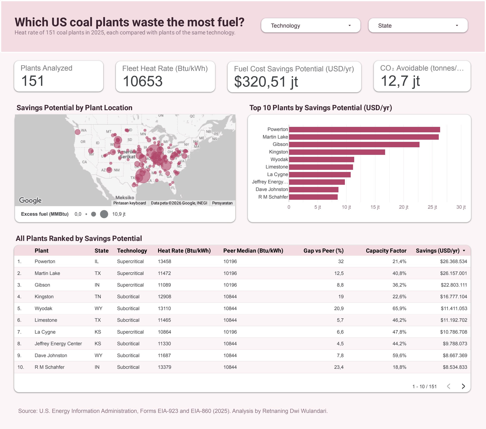
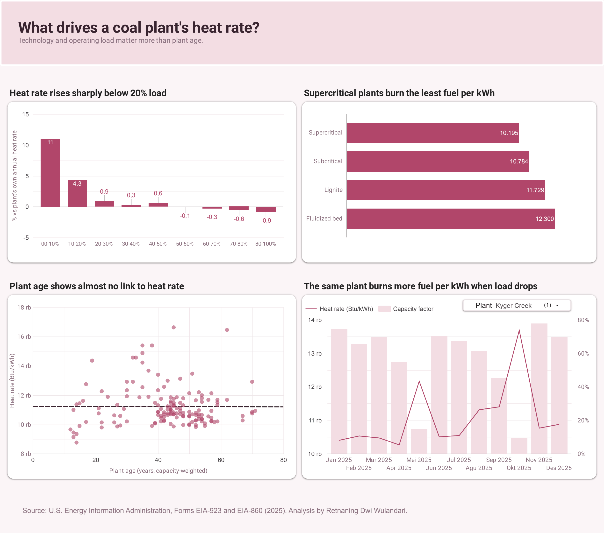

# US coal plant heat rate analysis (EIA 2025)

Which US coal plants burn more fuel than they should, and why?

I compared the heat rate of 151 US coal plants in 2025, each against plants of the same technology. If the 74 plants above their peer median reached that median, they would burn 2.0% less coal: about **USD 320 million in fuel and 12.7 million tonnes of CO2 per year**. Eleven plants hold half of that potential.

**[Open the interactive dashboard](https://datastudio.google.com/reporting/6a93fe92-a93f-4467-938b-3b0ae7c945bf)**



## Background

Heat rate is the amount of fuel a plant burns to produce 1 kWh of electricity, in Btu/kWh. A lower heat rate means less coal, lower cost and less CO2 for the same output. The average across the 151 plants is 10,653 Btu/kWh, or about 32% thermal efficiency.

Comparing every plant with the fleet average is unfair, because some technologies are less efficient by design. A plant that burns wet lignite will never match a supercritical plant. So each plant is compared only with its peer group:

| Peer group | Plants | Median heat rate (Btu/kWh) |
|---|---|---|
| Subcritical | 95 | 10,844 |
| Supercritical (incl. ultra-supercritical) | 34 | 10,196 |
| Fluidized bed | 15 | 12,912 |
| Lignite | 7 | 12,126 |

I worked as an intern at a coal-fired power plant in Indonesia, where heat rate is one of the main daily performance numbers. This project applies the same idea to a full national fleet using public data.

## Questions

1. How far is each plant from the median of its peer group?
2. How much fuel, cost and CO2 would be saved if the plants above the median reached it?
3. Which plants hold most of that potential?
4. What drives heat rate: technology, plant age, or operating load?

## Data

| Source | Used for |
|---|---|
| [EIA-923](https://www.eia.gov/electricity/data/eia923/) 2025, Generation and Fuel Data | Monthly fuel burned and net generation per plant |
| [EIA-860](https://www.eia.gov/electricity/data/eia860/) 2025, Generator and Plant files | Capacity, steam technology, boiler type, operating year, retirements, location |
| [EPA GHG Emission Factors Hub](https://www.epa.gov/climateleadership/ghg-emission-factors-hub) 2025 | CO2 factor for coal in the electric power sector: 95.52 kg/MMBtu |
| [EIA Electric Power Annual](https://www.eia.gov/electricity/annual/), Table 7.17 | Average coal cost for the electric power sector: USD 2.41/MMBtu |

The raw EIA files are not in this repository because of their size. To reproduce the analysis, download them from the links above and load them into BigQuery as `raw_923_genfuel_2025`, `raw_860_generator_operable_2025`, `raw_860_generator_retired_2025` and `raw_860_plant_2025`.

## Workflow


| Step | File | What it does |
|---|---|---|
| Load check | [00_check_row_counts.sql](sql/00_check_row_counts.sql) | Confirms that the four raw tables loaded completely. |
| Explore | [01_explore_raw_data.sql](sql/01_explore_raw_data.sql) | Looks at fuel types, prime movers, row structure and missing values. The results set the cleaning rules. |
| Clean | [02_clean_cfpp_monthly.sql](sql/02_clean_cfpp_monthly.sql) | Keeps coal steam turbine rows, drops CHP plants, turns 12 monthly columns into 12 rows, and sums to one row per plant per month. |
| Build | [03_build_cfpp_plants.sql](sql/03_build_cfpp_plants.sql) | Builds one row per plant: annual heat rate, capacity factor, unit details from EIA-860, peer group and analysis flags. |
| Analyze | [04_rank_plants.sql](sql/04_rank_plants.sql) | Ranks each plant within its peer group and against the fleet. |
| Analyze | [05_compare_technology_and_age.sql](sql/05_compare_technology_and_age.sql) | Tests whether plant age and technology explain heat rate. |
| Analyze | [06_compare_load_vs_heat_rate.sql](sql/06_compare_load_vs_heat_rate.sql) | Compares each plant's monthly heat rate with its own annual heat rate at different loads. |
| Analyze | [07_estimate_fuel_savings.sql](sql/07_estimate_fuel_savings.sql) | Estimates excess fuel, cost and CO2 against the peer median, with a sensitivity scenario. |
| Export | [08_export_dashboard_data.sql](sql/08_export_dashboard_data.sql) | Exports the three tables used by the dashboard. |

Column definitions for the exported tables are in [docs/data_dictionary.md](docs/data_dictionary.md).

### Which plants are in the analysis

| Step | Plants |
|---|---|
| Coal-fired steam turbine plants in EIA-923, excluding combined heat and power (CHP) | 243 |
| ... with positive net generation in 2025, so heat rate can be calculated | 181 |
| ... burning at least 90% coal | 157 |
| ... generating at least 100,000 MWh in the year | 154 |
| ... belonging to one of the four peer groups | **151** |

CHP plants (136) are excluded because part of their fuel produces steam for industry, not electricity, so their heat rate is not comparable. The final 151 plants produce 92% of the electricity from the 243 plants. Plants are not deleted from the plant table; they are flagged (`in_analysis`), so every exclusion can be traced.

### Data quality checks

Every file that builds a table ends with checks, so an error is caught before the next step uses the table.

- **Shape**: joins do not duplicate plants. One row per plant, and 151 plants x 12 months = 1,812 rows in the monthly table.
- **Reconciliation**: total generation after cleaning differs from the raw data by only 3.77 MWh out of 686 million MWh. The difference comes from EIA rounding.
- **Physical plausibility**: no monthly capacity factor is above 1 (maximum 0.974).
- **Sample check**: Trimble County (KY) and Powerton (IL) were recalculated by hand from the raw files.

## Findings

### 1. Half of the savings potential sits in 11 plants

Powerton (IL), Martin Lake (TX) and Gibson (IN) are the top three, each with more than USD 22 million in excess fuel per year. A fleet-wide program is not needed: a heat rate audit of the 11 largest plants would cover half of the potential.

If all 74 plants closed only half of their gap, the savings would still be about USD 160 million per year.

### 2. Technology sets the baseline

The median supercritical plant runs at 10,196 Btu/kWh, 6% lower than the median subcritical plant (10,844). This is why plants are compared within peer groups and not against the fleet.

### 3. Low load raises heat rate sharply

In months below 10% load, a plant's heat rate was a median 11% higher than its own annual heat rate. Between 10% and 20% load it was 4% higher. Above 50% load it was slightly below its average. At low load the boiler still loses heat through its walls and flue gas, and the auxiliary equipment still runs, but these losses are spread over fewer kWh.

Each plant is compared with itself here, so differences in technology or coal type do not affect the result.

This changes how finding 1 should be read. Powerton ran at only a 21% capacity factor in 2025, so part of its gap comes from how it was dispatched, not only from the condition of the plant.

### 4. Plant age shows almost no link to heat rate

The correlation between plant age and heat rate across the 151 plants is close to zero (-0.002). Old plants are not automatically inefficient. One likely reason is survivorship bias: the least efficient old plants have already retired, so the old plants still running are the better ones.



## Dashboard

The [Data Studio dashboard](https://datastudio.google.com/reporting/6a93fe92-a93f-4467-938b-3b0ae7c945bf) has two pages.

- **Savings potential**: key numbers, a map of all 151 plants, the top 10 plants by excess fuel cost, and a ranking table. It can be filtered by technology and state.
- **What drives heat rate**: heat rate by load band, by technology and by plant age, and a monthly view of one selected plant showing how its heat rate moves with its load.

## Limitations

- **This is technical potential, not a forecast.** Reaching the peer median may need capital investment, and some of the gap cannot be removed at all.
- **Load is set by the market.** A plant dispatched at low load shows a higher heat rate even when it is well maintained.
- **Fuel cost and CO2 factor are national averages.** The real coal price and coal quality differ between plants.
- **Technology is assigned per plant**, from the largest coal unit. Plants with mixed units are simplified.
- **Capacity factor uses nameplate capacity**, which is usually higher than the capacity a plant can actually deliver.
- **Monthly data cannot separate start-ups** from steady operation, so the low-load effect includes start-up fuel.
- **Survivorship bias**: retired plants are not in the 2025 data, which weakens any conclusion about age.

## Repository structure

```
cfpp-heat-rate-analysis/
├── sql/       SQL scripts, run in order 00 to 08
├── data/      Final tables exported for the dashboard
├── docs/      Data dictionary
└── images/    Dashboard screenshots
```

## Tools

- **Google BigQuery (SQL)**: CTEs, joins, unpivoting with `UNNEST`, window functions (`RANK`, `NTILE`, `PERCENTILE_CONT`, running totals), and validation queries
- **Google Sheets**: bridge between BigQuery and the dashboard
- **Data Studio (formerly Looker Studio)**: interactive dashboard

## Author

**Retnaning Dwi Wulandari**
Physics graduate (Electronic Instrumentation) from Institut Teknologi Sepuluh Nopember, Indonesia, with internship experience in instrumentation and control at a coal-fired power plant.

[LinkedIn](https://www.linkedin.com/in/retnaning-dwi-wulandari)
